> [!IMPORTANT]
> **Pro features are, for now, only available in the Play Store release.** The one-time Pro
> unlock — RetroAchievements and RomM — cannot be bought from this build yet. We are working on
> bringing it here; everything else in Blip is free and works the same in both.

# Blip

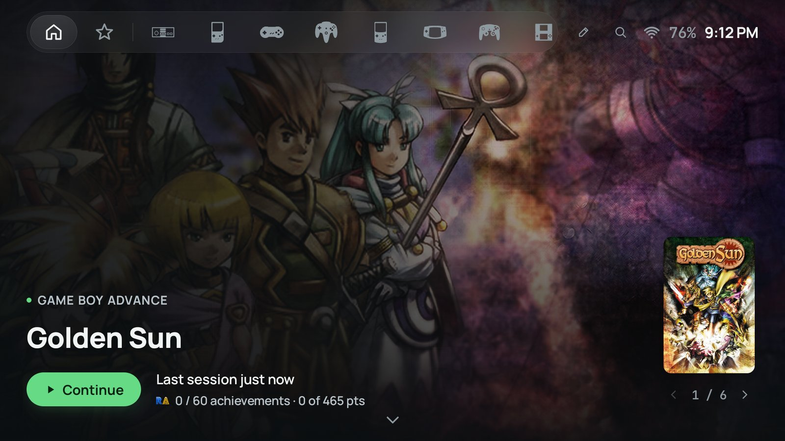

**Your games, one controller.** 
A game launcher for Android handhelds — the shelf your emulators never gave you.

[Download APK](https://github.com/goblip/blip/releases/latest) · [Website](https://goblip.co) · [Themes](https://themes.goblip.co) · [Discord](https://discord.gg/M7PFqGc7pz) · [Privacy](https://goblip.co/privacy)

[](https://apps.obtainium.imranr.dev/redirect?r=obtainium%3A%2F%2Fapp%2F%7B%22id%22%3A%22com.bliplauncher.github%22%2C%22url%22%3A%22https%3A%2F%2Fgithub.com%2Fgoblip%2Fblip%22%2C%22author%22%3A%22goblip%22%2C%22name%22%3A%22Blip%22%2C%22preferredApkIndex%22%3A0%2C%22additionalSettings%22%3A%22%7B%5C%22includePrereleases%5C%22%3Afalse%2C%5C%22fallbackToOlderReleases%5C%22%3Atrue%2C%5C%22filterReleaseTitlesByRegEx%5C%22%3A%5C%22%5C%22%2C%5C%22filterReleaseNotesByRegEx%5C%22%3A%5C%22%5C%22%2C%5C%22verifyLatestTag%5C%22%3Afalse%2C%5C%22sortMethodChoice%5C%22%3A%5C%22date%5C%22%2C%5C%22useLatestAssetDateAsReleaseDate%5C%22%3Afalse%2C%5C%22releaseTitleAsVersion%5C%22%3Afalse%2C%5C%22trackOnly%5C%22%3Afalse%2C%5C%22versionExtractionRegEx%5C%22%3A%5C%22%5C%22%2C%5C%22matchGroupToUse%5C%22%3A%5C%22%5C%22%2C%5C%22versionDetection%5C%22%3Atrue%2C%5C%22releaseDateAsVersion%5C%22%3Afalse%2C%5C%22useVersionCodeAsOSVersion%5C%22%3Afalse%2C%5C%22apkFilterRegEx%5C%22%3A%5C%22%5C%22%2C%5C%22invertAPKFilter%5C%22%3Afalse%2C%5C%22autoApkFilterByArch%5C%22%3Atrue%2C%5C%22appName%5C%22%3A%5C%22Blip%5C%22%2C%5C%22appAuthor%5C%22%3A%5C%22Goblip%5C%22%2C%5C%22about%5C%22%3A%5C%22%5C%22%2C%5C%22refreshBeforeDownload%5C%22%3Afalse%2C%5C%22includeZips%5C%22%3Afalse%2C%5C%22zippedApkFilterRegEx%5C%22%3A%5C%22%5C%22%7D%22%2C%22overrideSource%22%3Anull%7D)

## About

Blip turns any Android device into a game console. One shelf, real box art, achievements on the
covers, and an interface you drive entirely with a controller. You bring the files and the
emulator apps — it brings everything else.

It is a launcher, not an emulator, and it does not come with games.

## Features

### Point it at a folder

Pick the folder your ROMs live in and Blip reads what is inside: each subfolder recognised by its
name, or by its files when the name says nothing. You get back a table — system, folders, games,
emulator, core — and nothing joins the library until you say so. It knows **41 systems**, which
apps play each one and which core to load.

  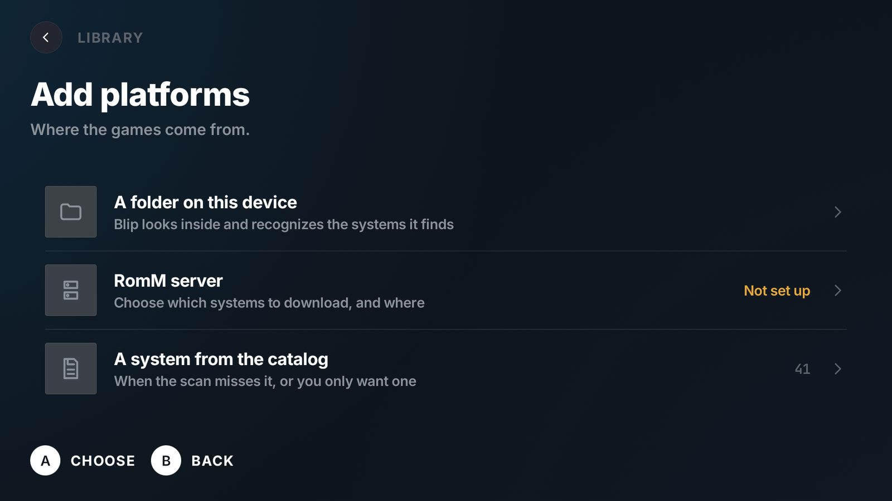
  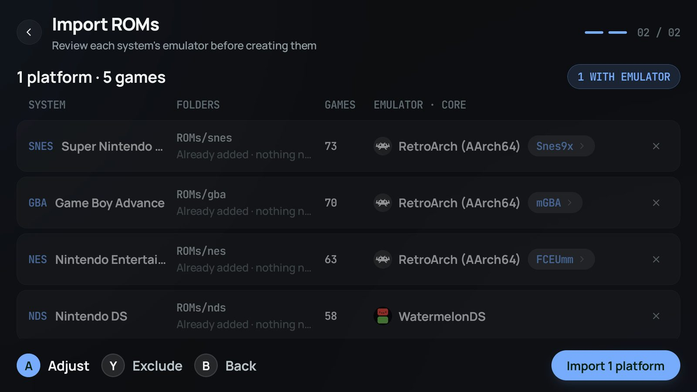

- **Art that turns up on its own.** Covers, backgrounds, logos, descriptions — drawn from several
  places so you never have to pick one. Anything it gets wrong, you fix by hand.
- **Fitted to each platform.** Tall cases, square cartridges, wide discs. A shelf never looks
  stretched or cropped.
- **Shelf, grid or list.** Browse slowly, see everything at once, or find one game in a library of
  hundreds.
- **Your folders, wherever they are.** Internal storage, SD card, USB drive. Zipped ROMs are fine,
  and multi-disc sets and regional copies arrive as one game.
- **Back where you left.** It opens on the last game, so most nights one button puts you back in.

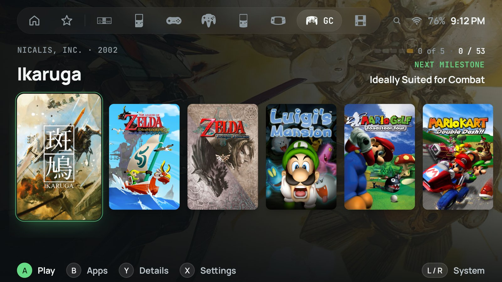

### Your trophies, on the covers

Connect your RetroAchievements account and every game carries its progress while you browse. The
full list — points, rarity, unlock dates, what to go for next — sits on the game's page. Nothing
is written back; the earning still happens in your emulator.

> [!NOTE]
> RetroAchievements is a Pro feature and the GitHub build cannot unlock Pro yet — work in
> progress. Today it is available in the [Play Store release](https://play.google.com/store/apps/details?id=com.bliplauncher).

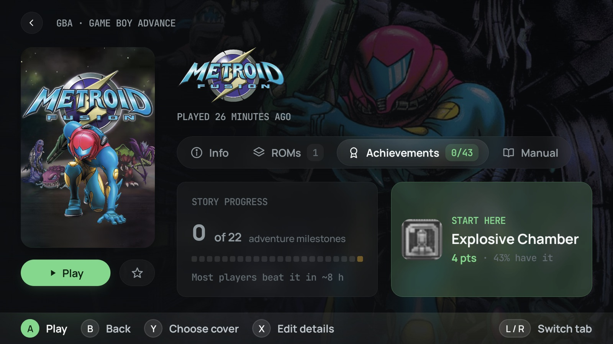

  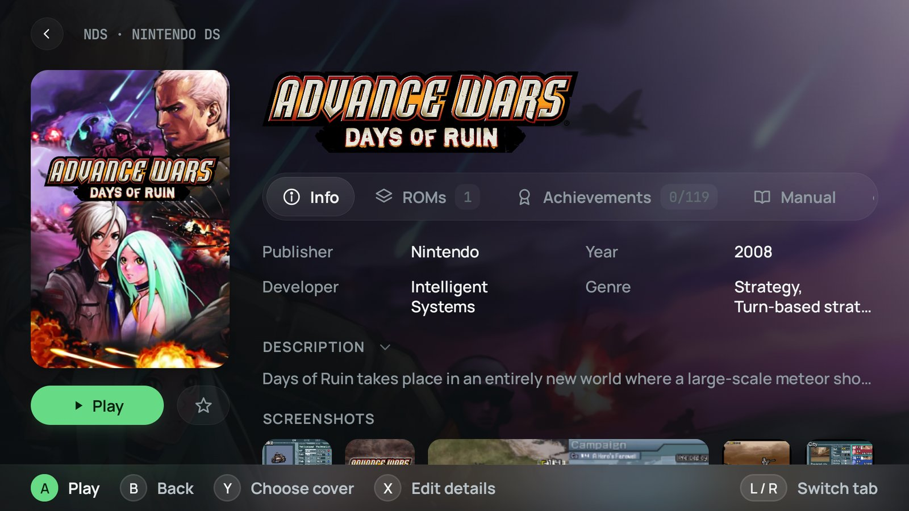
  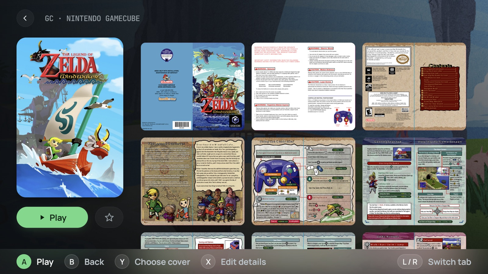

### Built for a controller, not adapted to one

Every screen is reachable with a d-pad and four buttons, and the hints along the bottom always say
what each one does. Buttons answer to the letter printed on them, not the one Android reports. No
touchscreen required. Set Blip as the home app and the shelf is the first thing the device shows
when it wakes.

### Two screens, one device

On a dual-screen handheld like the AYN Thor the panels split by function: the game you are
looking at fills the top one, the whole library sits under your thumb on the bottom one. Nothing
is shown twice. Once you are playing, the lower panel stays black until you tap it — what you
launched, how long you have been at it, and the way back.

  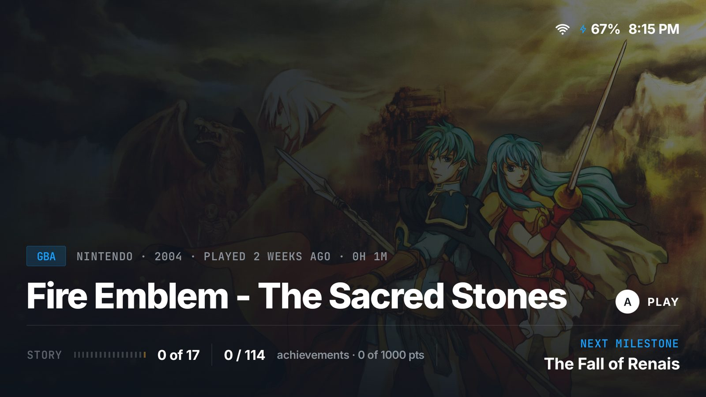 
  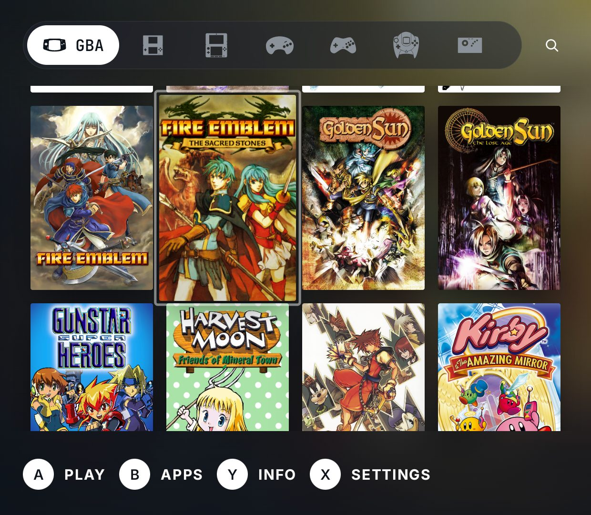

### Your own server, on the shelf

Pair a self-hosted [RomM](https://romm.app) server and its library lands on the shelf beside your
local folders: what you browse is the whole collection on your network, not only what is on the
device. Remote games download on demand.

> [!NOTE]
> RomM is a Pro feature and the GitHub build cannot unlock Pro yet — work in progress. Today it
> is available in the [Play Store release](https://play.google.com/store/apps/details?id=com.bliplauncher).

### Nothing to sign up for, nothing watching you

Blip reads the folders you point it at and nothing else. No account required, no ads, no
telemetry. The only thing that leaves the device is a game title, and only while it looks for
artwork.

## Themes

A theme here is not a colour swap. Three ship with Blip, each in light and dark; the 16 bit one
squares every corner and was made for the handhelds built to look like 1994 — run it on one and
the screen finally matches the shell in your hands.

Themes are plain JSON files, and the [theme gallery](https://themes.goblip.co) installs community
themes from inside the app.

  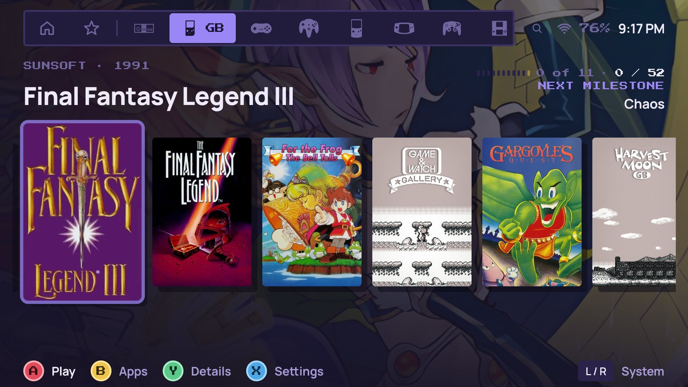
  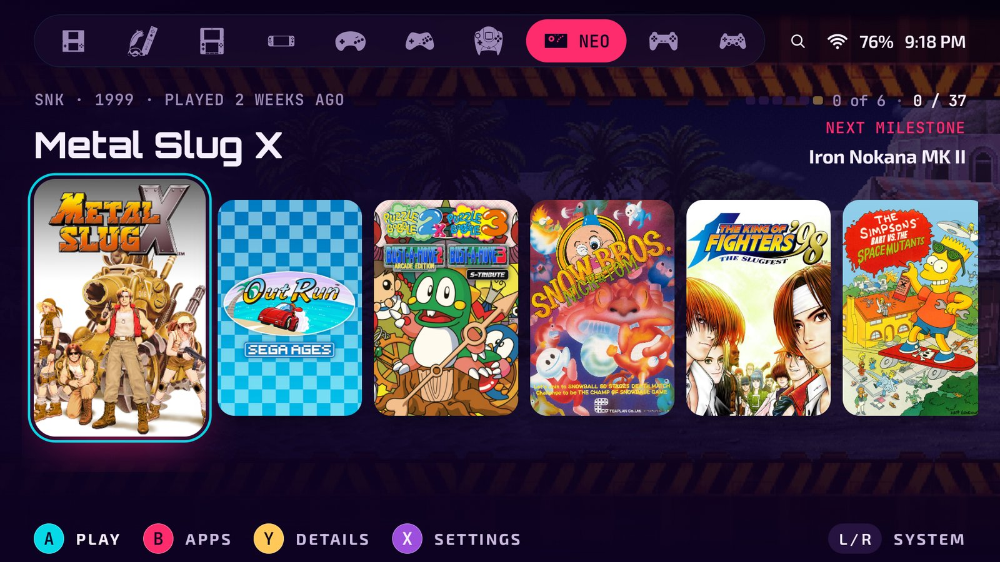
  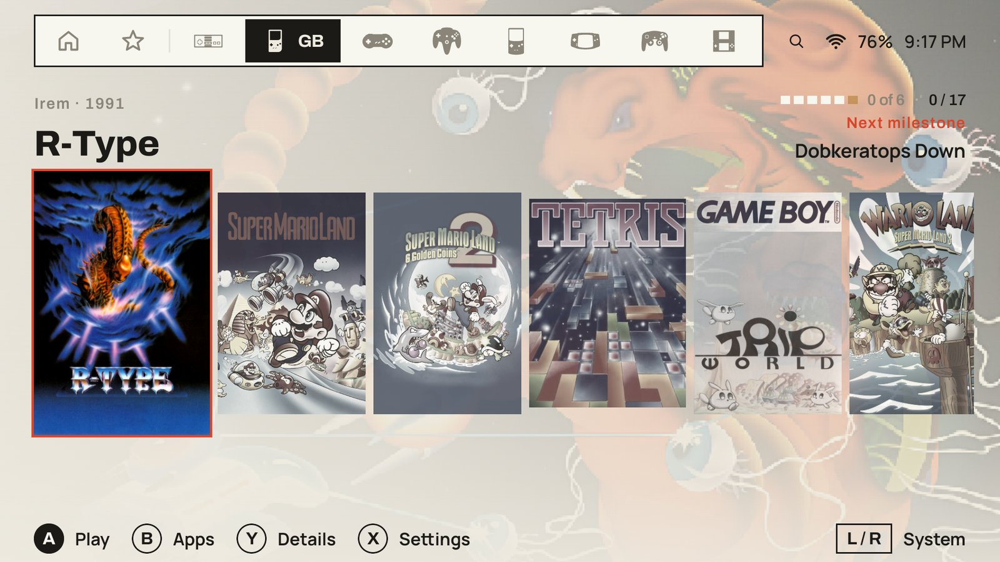
  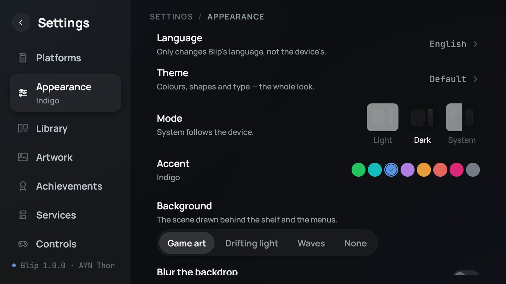

## Installation

The APK on the [Releases](https://github.com/goblip/blip/releases/latest) page is the same Blip as
the Play Store one, packaged as `com.bliplauncher.github` so it installs beside the Play build
rather than over it.

[](https://apps.obtainium.imranr.dev/redirect?r=obtainium%3A%2F%2Fapp%2F%7B%22id%22%3A%22com.bliplauncher.github%22%2C%22url%22%3A%22https%3A%2F%2Fgithub.com%2Fgoblip%2Fblip%22%2C%22author%22%3A%22goblip%22%2C%22name%22%3A%22Blip%22%2C%22preferredApkIndex%22%3A0%2C%22additionalSettings%22%3A%22%7B%5C%22includePrereleases%5C%22%3Afalse%2C%5C%22fallbackToOlderReleases%5C%22%3Atrue%2C%5C%22filterReleaseTitlesByRegEx%5C%22%3A%5C%22%5C%22%2C%5C%22filterReleaseNotesByRegEx%5C%22%3A%5C%22%5C%22%2C%5C%22verifyLatestTag%5C%22%3Afalse%2C%5C%22sortMethodChoice%5C%22%3A%5C%22date%5C%22%2C%5C%22useLatestAssetDateAsReleaseDate%5C%22%3Afalse%2C%5C%22releaseTitleAsVersion%5C%22%3Afalse%2C%5C%22trackOnly%5C%22%3Afalse%2C%5C%22versionExtractionRegEx%5C%22%3A%5C%22%5C%22%2C%5C%22matchGroupToUse%5C%22%3A%5C%22%5C%22%2C%5C%22versionDetection%5C%22%3Atrue%2C%5C%22releaseDateAsVersion%5C%22%3Afalse%2C%5C%22useVersionCodeAsOSVersion%5C%22%3Afalse%2C%5C%22apkFilterRegEx%5C%22%3A%5C%22%5C%22%2C%5C%22invertAPKFilter%5C%22%3Afalse%2C%5C%22autoApkFilterByArch%5C%22%3Atrue%2C%5C%22appName%5C%22%3A%5C%22Blip%5C%22%2C%5C%22appAuthor%5C%22%3A%5C%22Goblip%5C%22%2C%5C%22about%5C%22%3A%5C%22%5C%22%2C%5C%22refreshBeforeDownload%5C%22%3Afalse%2C%5C%22includeZips%5C%22%3Afalse%2C%5C%22zippedApkFilterRegEx%5C%22%3A%5C%22%5C%22%7D%22%2C%22overrideSource%22%3Anull%7D)

### Manual installation

1. Download the latest APK from [Releases](https://github.com/goblip/blip/releases/latest).
2. Allow installs from your browser or file manager when Android asks.
3. Install the APK.

### Where it runs

Any Android 12 or newer device — a retro handheld, a phone or a tablet. Built and tested on the
AYN Thor and the Retroid Pocket. No root, no special hardware. Nine languages.

## Free, with a one-time Pro unlock

The app is free and carries no ads. Everything the launcher itself does — the shelf, the artwork,
the themes, the second screen — is free. One purchase, once, unlocks the two features that talk to
a service on your behalf: **RetroAchievements** and **RomM**. For now that purchase is only
available in the [Play Store release](https://play.google.com/store/apps/details?id=com.bliplauncher).

## Resources

- [Website](https://goblip.co)
- [Latest release](https://github.com/goblip/blip/releases/latest)
- [Themes](https://themes.goblip.co)
- [Privacy policy](https://goblip.co/privacy)

## Support

For help, bug reports and feature requests, [join the Discord](https://discord.gg/M7PFqGc7pz).

---

Blip is a launcher, not an emulator. It does not include, host, sell or download game files of any
kind — you supply your own files and your own emulator apps. The app is not open source; this
repository publishes its releases. 
© Goblip · <a href="https://goblip.co">goblip.co</a>

